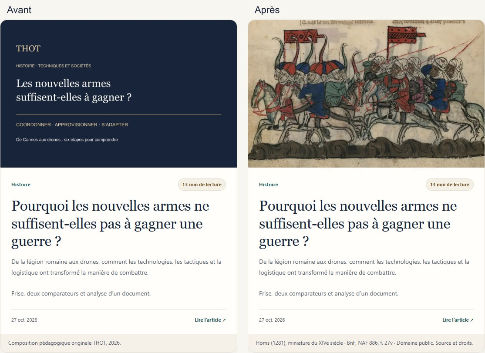
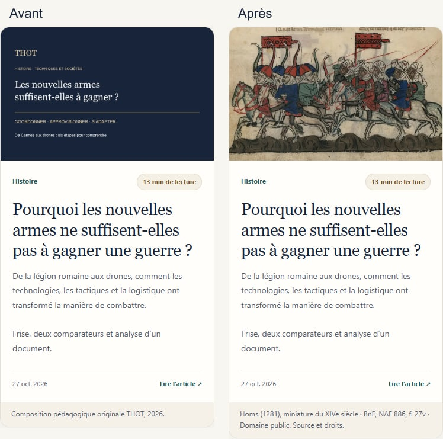

# Couverture de l’article sur les stratégies militaires

Vérification du 4 novembre 2026, depuis main 781025b01479c326ec43cbacc249b650cbd8d13e.

## Diagnostic et correction

La carte utilisait social.png, une composition typographique de partage en 1200 × 630, avec la classe discovery-photo--integrale qui impose object-fit: contain. Le titre était répété en petit et l’image ne remplissait pas le cadre 16:10 commun aux cartes.

La carte utilise désormais homs.webp (960 × 557), déjà présent dans le dépôt et dans l’article : miniature du XIVe siècle représentant Homs (1281), BnF, NAF 886, f. 27v, domaine public. Le crédit visible renvoie à la notice originale. Le cadre commun applique object-fit: cover ; aucun CSS n’a changé.

L’article n’apparaît pas sur l’accueil : aucune modification de cette page. Open Graph, Twitter et le JSON-LD conservent leur visuel de partage dédié en 1200 × 630 ; URL accessible et dimensions vérifiées par le contrôle SEO. Aucune modification du contenu de l’article ni des autres couvertures.

## Captures réelles de navigateur

Avant à gauche, après à droite. Chrome headless, échelle 1 ; mobile simulé, sans appareil physique.

Ordinateur, fenêtre de 1440 px :

Mobile, fenêtre de 390 px :

## Vérifications

- Navigateur à 320, 390, 768 et 1440 px : image décodée, aucun débordement, aucune erreur JavaScript ou ressource locale en échec ; bibliothèque et accueil vérifiés.
- Comparaison avant/après des styles calculés : dimensions du cadre, rapport 16:10, filtre, arrondis et ombre identiques ; toutes les propriétés relevées des cinq autres cartes sont inchangées.
- node scripts/test-bibliotheque.mjs : succès.
- node scripts/check-home.mjs : succès.
- python scripts/check-seo.py : 18 pages, aucune erreur ni avertissement.
- python scripts/test-article-editorial.py : succès (un contrôle optionnel de révisions non activé).
- python scripts/test-strategies-static.py --content-only : succès, contenu et empreintes des médias conservés. Le mode historique sans cette option compare à 5231c61 et inclut les changements antérieurs déjà fusionnés ; le périmètre de cette correction a été contrôlé séparément.
- python scripts/update-article-editorial.py --check et python scripts/sync-publication.py --check : succès.
- git diff --check : succès ; hors preuves de vérification, seule bibliotheque.html change.
